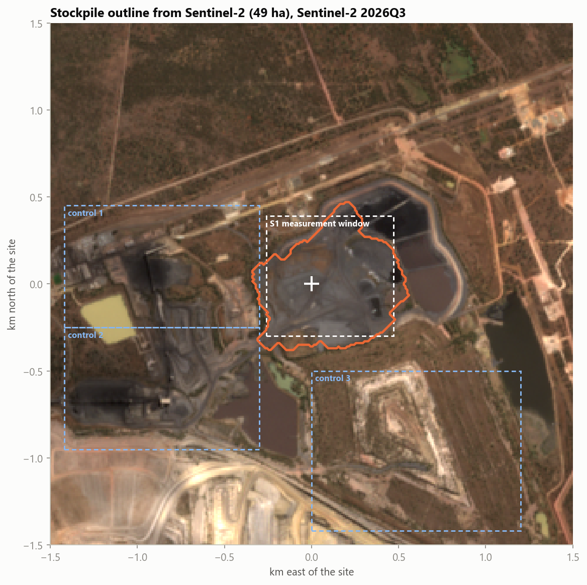

# Coal stockpile — volume through time

**Copernicus DEM + Sentinel-1 + Sentinel-2** (plus SRTM 2000 and ALOS AW3D30) for a bunded stockpile of
black material (coal / coal rejects) next to the preparation plant of an open-cut mine.
Name and location are masked on purpose: maps use km from the site, and the real coordinates live in a
local `site.json` that is not in the repository.



## Results

| | |
|---|---|
| stockpile footprint (Sentinel-2 outline) | **49 ha** |
| 2000 (SRTM) | flat ground, no stockpile yet |
| ~2008 (ALOS) | **3.6 Mm³**, mean height 7.4 m |
| ~2012 (Copernicus) | **5.5 Mm³**, mean height 11.3 m, up to ~19 m |
| 2016Q3 → 2026Q3 (Sentinel-1) | height **stable**: annual medians between −1.2 and +1.7 m |
| trend 2016–2026 | **+0.09 ± 0.10 m/yr** → +0.04 ± 0.05 Mm³/yr (zero within the error) |
| black-material cover (Sentinel-2) | 45–48 ha (2016–18) → 33–35 ha (2024–26) |

The stockpile grew to ~5.5 Mm³ between 2000 and 2012. Since 2016 its volume has not changed beyond
±1 Mm³. Sentinel-2 shows that since ~2021 a shrinking part of the surface is covered by fresh black
material, and Sentinel-1 activity (dumping, dozers) is clearly lower after 2019. Both fit a stockpile that
receives little new material and whose surface is weathering. The satellite data cannot tell why.

## Method

1. **DEMs → measured volume up to 2012.** Height = epoch DEM − SRTM 2000 (flat ground before the
   stockpile), after vertical alignment on stable ground.
2. **Sentinel-2 → outline and cover.** Coal has a flat, low spectrum (NIR < 0.10, red < 0.09). Water is
   dark too, but not in the SWIR (B11 < 0.04). Quarterly medians of cloud-free scenes (SCL mask), with the
   BOA offset of processing baseline 04.00 removed.
3. **Sentinel-1 → height change after 2016 (radargrammetry from geocoding).** RTC scenes are geocoded
   with Copernicus DEM. A surface Δh higher than the DEM appears shifted towards the satellite by
   Δh · cot θ (θ = 38.2° from the scene annotation, i.e. 1 m of height = 1.27 m of shift):
   * normalised cross-correlation within ±60 m with a parabolic sub-pixel peak,
   * a **network of pairs** 1–4 quarters apart solved by least squares (as in SBAS), because the stockpile
     texture changes after dumping and a comparison with 2016 loses correlation,
   * reference = **median of three stable control windows**. All windows move together by several metres
     at times, which reflects changes in Sentinel-1 orbit processing, not terrain,
   * noise = spread of the control windows (σ ≈ 1.9 m per quarter),
   * **injection test**: a known ±3 m / +6 m step added to the real images comes back with the right sign and
     no false signal before the step. The sensitivity of 0.79 is calibrated out.

## Data

Everything comes from [Microsoft Planetary Computer](https://planetarycomputer.microsoft.com) (no account
needed), read with `pystac-client` + `planetary-computer` + `odc-stac`. Only the site window is read
from each Cloud-Optimized GeoTIFF.

| data | collection | use |
|---|---|---|
| Copernicus DEM GLO-30 | `cop-dem-glo-30` | heights ~2012 (TanDEM-X 2011–15), also the geocoding DEM of S1 RTC |
| SRTM | `nasadem` | heights February 2000 |
| ALOS AW3D30 | `alos-dem` | heights 2006–11 |
| Sentinel-1 RTC | `sentinel-1-rtc` | VV/VH gamma0, 10 m, one relative orbit (the most frequent one) |
| Sentinel-1 GRD | `sentinel-1-grd` | product annotation of one scene: incidence angle and heading |
| Sentinel-2 L2A | `sentinel-2-l2a` | reflectance B02–B12 + SCL cloud mask |

## Running it

```bash
pip install -r requirements.txt
cp site.example.json site.json   # fill in lat/lon and the control windows
python run_all.py                # downloads (~1 h, cached) → analysis → test → charts → 3D → notebook
```

`site.json` fields: `lat`, `lon`, `half_size_m` (window, default 1500 m), `first_quarter`/`last_quarter`,
`control_windows_km` (three stable, textured areas such as buildings and conveyors, given as
`[x0, x1, y0, y1]` in km from the site; pick ones with quarter-to-quarter correlation ≥ 0.7, not grassland)
and `natural_window_km` (undisturbed ground, the reference for the activity threshold).

| file | role |
|---|---|
| `config.py` | site, UTM zone (automatic), grids, quarters |
| `download.py` | DEMs, S1 geometry, S1 and S2 quarterly composites |
| `analysis.py` | outline, DEM history, S1 height network, S2 cover, activity → `out/` |
| `sensitivity.py` | injection test → `out/sensitivity_test.json` (calibration) |
| `plots.py`, `style.py` | charts |
| `viewer.py`, `viewer_template.html` | 3D viewer (three.js) |
| `notebook.py` | builds and executes `analysis.ipynb` |
| `run_all.py` | everything in order |

## Outputs

| path | content |
|---|---|
| `analysis.ipynb` | executed notebook with all charts |
| `out/stockpile_3d.html` | **3D viewer**: 2000 → ~2008 → ~2012 → quarters since 2016 (opens from disk) |
| `out/01…06_*.png` | map, DEM history, S1 height, cover and activity, S2 mosaic, sensitivity test |
| `out/stockpile_summary.json` | the numbers above + method metrics |
| `out/stockpile_quarterly.csv`, `out/stockpile_dem.csv` | tables (generated locally, CSV files are not kept in git) |

## Limitations

* **The 2012 → 2016 gap** is not covered by any free height measurement. The S1 series is relative (from 2016Q3).
* S1 measures the **mean** height change in the stockpile window. Reworking inside it cancels out.
* The detectable annual change is ~2 m, i.e. ~1 Mm³ on this footprint.
* The last quarters of the series have fewer pairs in the network, so they are less constrained.
* Optical data cannot tell saleable coal from coal rejects: both are black.
