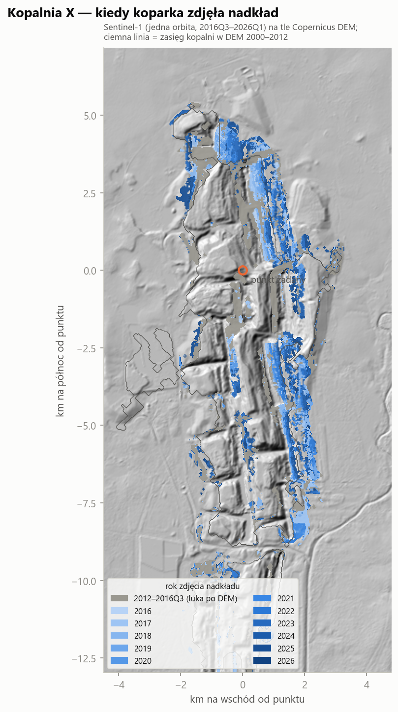

# Kopalnia X — objętość robót ziemnych w czasie

**Copernicus DEM + Sentinel-1** (oraz SRTM 2000 i ALOS AW3D30 jako dodatkowe epoki wysokości)
dla dużej kopalni pasowej węgla. Nazwa i położenie są celowo zamaskowane — mapy mają współrzędne w km
od punktu odniesienia.

## Wyniki

| | |
|---|---|
| okres Sentinel-1 | 2016Q3 – 2026Q3, 41 kwartałów (jedna orbita zstępująca) |
| **nadkład zdjęty 2016Q4 – 2026Q1** | **≈ 1 340 mln m³** (zakres 1 220 – 1 455 przy błędzie spągu ±10 m) |
| średnie tempo | **≈ 140 mln m³/rok**, rekord 2024: ~230 mln m³ |
| luka 2012 → 2016Q3 (przed S1) | ≈ 650 mln m³, czyli ~160 mln m³/rok |
| powierzchnia nowych pasów | ≈ 1 180 ha |
| średnia głębokość wykopu | ≈ 114 m, rośnie z ~85 m (2017) do ~130–150 m (2024–25) |
| zmierzone z DEM 2000 → ~2008 → ~2012 | wykop 700 / 278 mln m³, nasyp 698 / 283 mln m³ (bilans się zamyka) |

Liczony jest tylko nadkład pierwotny (bez przerzutów zwałowisk), w kadrze 18 × 22 km.

## Jak to jest mierzone

1. **Trzy DEM-y → zmierzone zmiany.** SRTM (2000), ALOS AW3D30 (2006–11) i Copernicus GLO-30
   (TanDEM-X 2011–15) z Planetary Computer, na wspólnej siatce 30 m, wyrównane pionowo
   medianą różnic na stepie. Różnica = m³ wykopu i nasypu (dolna granica: pas wykopany i zasypany między
   epokami nie zostawia śladu).
2. **Model spągu pokładu.** Dna wyrobisk z trzech epok (minima przekrojów W–E, prominencja ≥ 40 m,
   bez płaskich luster wody) → regresja kwantylowa dolnego kwartyla: liniowa w osi upadu, spline wzdłuż
   rozciągłości. Test ekstrapolacji: model z 2000 + 2008 przewiduje dna z 2012 (leżące dalej na wschód)
   z 10. i 25. percentylem błędu −9 / +3 m. Upad ~2,6° na wschód.
3. **Gdzie pokład leżał jeszcze w 2012 r.** Bez obrysu kopalni z 2000 r., bez miejsc, gdzie wyrobisko
   sięgnęło spągu, i bez zwałów (> 8 m nad terenem z 2000 r.). Zostaje step i ławy pre-stripu.
4. **Sentinel-1 RTC → kiedy.** Kwartalne mediany VV/VH (10 m → 30 m) z korektą sezonu względem stepu.
   Klasyfikator *pokład zdjęty (wyrobisko/zwał) vs pokład na miejscu* uczony na etykietach z DEM
   (AUC 0,81 na blokach przestrzennych; drugi, *kopalnia vs step*: AUC 0,96). Kwartał wykopu = pierwszy
   kwartał, od którego „pokład zdjęty” trzyma się w ≥ 80% dalszych kwartałów.
5. **m³ = Σ (teren ~2012 − spąg) × 900 m²** po komórkach wykopanych w danym kwartale.

Walidacja na surowym sygnale: kymografy (`07_kymografy.png`) pokazują ukośne prążki pasów wędrujących
na wschód, a wykryte kwartały wykopu leżą na tych frontach. Głębokość nie jest wejściem detekcji, a rośnie
z czasem wykopu, tak jak powinna przy schodzeniu w dół upadu.

## Pliki

| ścieżka | zawartość |
|---|---|
| `analiza.ipynb` | **notatnik ze wszystkimi wykresami**, wykonany |
| `out/viewer_3d.html` | **viewer 3D kwartał po kwartale** (three.js, jeden plik, działa z dysku) |
| `out/wykresy/*.png` | 10 wykresów i map |
| `out/objetosci_kwartalne.csv` | kwartał: ha, głębokość, mln m³ (min/max), narastająco |
| `out/objetosci_dem.csv` | zmierzone objętości z par DEM |
| `out/aktywnosc.csv` | powierzchnia zmian radarowych kwartał do kwartału |
| `out/podsumowanie.json` | liczby z tabeli wyżej + metryki walidacji |

Kod (lokalnie, poza gitem): `s1.py` (kompozyty, ~25 min) → `dem.py` → `run.py` → `plot.py` →
`build_viewer.py` → `build_notebook.py`. Moduły: `config`, `seam` (spąg), `detect` (S1),
`volume` (bilans + schemat powierzchni).

## Ograniczenia

* Liczony jest **nadkład pierwotny** (calizna nad pokładem). Przerzuty, zwałowanie i drogi widać
  w aktywności (`10_aktywnosc.png`), ale nie w m³.
* Data wykopu ma dokładność kwartału–dwóch: pas przechodzi przez stan wyrobiska i zwału.
* **2026Q2–Q3 niepotwierdzone**: warunek trwałości wymaga ≥ 3 kwartałów obserwacji.
* Luka 2012 → 2016Q3 (brak S1 na tej orbicie) jest zebrana w jednym kwartale.
* Jeden pokład; błąd ekstrapolacji spągu ~±10 m. Pojedyncze plamy na zachodnim skraju (zwały na
  wychodni) mogą być zaliczone do wykopu.
* Kadr nie obejmuje całego kompleksu: pasy ciągną się dalej na południe.
* Kształt zwałowisk w 3D jest schematyczny (pas zasypany po 4 kwartałach, rozluzowanie 1,25).
  Rzeczywiste są położenie i czas wykopu (S1) oraz głębokość (DEM + spąg).

Źródła danych: Microsoft Planetary Computer (`sentinel-1-rtc`, `cop-dem-glo-30`, `nasadem`, `alos-dem`).
