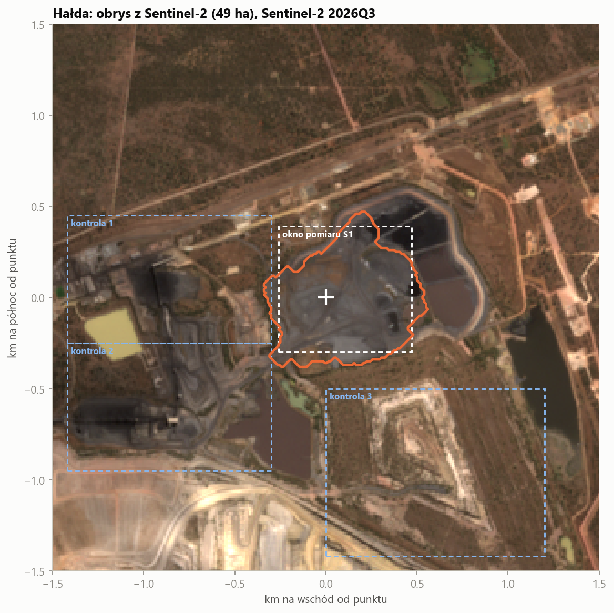

# Hałda węgla — objętość w czasie

**Copernicus DEM + Sentinel-1 + Sentinel-2** (oraz SRTM 2000 i ALOS AW3D30) dla obwałowanej hałdy
czarnego materiału (węgiel / odpady węglowe) przy zakładzie przeróbczym kopalni odkrywkowej.
Nazwa i położenie celowo zamaskowane: mapy mają współrzędne w km od punktu hałdy.

## Wyniki

| | |
|---|---|
| powierzchnia hałdy (obrys z S2) | **49 ha** |
| 2000 (SRTM) | płaski teren, hałdy jeszcze nie ma |
| ~2008 (ALOS) | **3,8 mln m³**, średnio 7,9 m wysokości |
| ~2012 (Copernicus) | **5,6 mln m³**, średnio 11,6 m, do ~19 m |
| 2016Q3 → 2026Q3 (Sentinel-1) | wysokość **stabilna**: roczne mediany w zakresie −1,2 … +1,8 m |
| trend 2016–2026 | **+0,09 ± 0,10 m/rok** → +0,04 ± 0,05 mln m³/rok (zero w granicach błędu) |
| pokrycie czarnym materiałem (S2) | 45–48 ha (2016–18) → 33–35 ha (2024–26) |

Wniosek: hałda urosła do ~5,6 mln m³ w latach 2000–2012, a od 2016 r. jej objętość się nie zmienia
(±1 mln m³). Sentinel-2 pokazuje za to, że od ok. 2021 r. coraz mniejszą część powierzchni pokrywa świeży,
czarny materiał, a aktywność radarowa (zwałowanie, ruch spycharek) jest po 2019 r. wyraźnie niższa.
Oba sygnały pasują do hałdy, na którą niewiele się już dosypuje i której powierzchnia szarzeje. Z danych
satelitarnych nie da się jednak ustalić przyczyny.

## Jak to jest mierzone

1. **DEM → zmierzona objętość do 2012.** Wysokość = DEM epoki − SRTM 2000 (płaski step przed hałdą),
   po wyrównaniu pionowym na stabilnym terenie (rozrzut 1,3–1,7 m).
2. **Sentinel-2 → obrys i pokrycie.** Węgiel ma płaskie, niskie widmo (NIR < 0,10, czerwony < 0,09).
   Woda też jest ciemna, ale nie w SWIR (B11 < 0,04). Kwartalne mediany scen bez chmur, z poprawką
   offsetu BOA (baseline 04.00).
3. **Sentinel-1 → zmiana wysokości po 2016 (radargrametria z geokodowania).** Sceny RTC są geokodowane
   Copernicus DEM. Punkt wyższy o Δh przesuwa się na obrazie w stronę satelity o Δh·ctg θ
   (θ = 38,2° z adnotacji sceny, 1 m wysokości = 1,27 m przesunięcia). Kroki:
   * znormalizowana korelacja w zakresie ±60 m z paraboliczną precyzją podpikselową,
   * **sieć par** kwartałów odległych o 1–4 kwartały i inwersja najmniejszych kwadratów (jak w SBAS),
     bo tekstura hałdy zmienia się po zwałowaniu i porównanie z 2016 r. traci korelację,
   * odniesienie: **mediana trzech stabilnych okien**. Wszystkie okna przesuwają się wspólnie o ~8 m między
     2016Q3 a 2017Q3, co jest zmianą geolokacji S1, a nie terenu,
   * szum = rozrzut okien kontrolnych (σ ≈ 1,9 m na kwartał),
   * **test wstrzyknięcia**: znany skok ±3 m i +6 m dodany do prawdziwych obrazów wraca z właściwym
     znakiem i bez fałszywego sygnału przed skokiem. Czułość 0,79 jest skalibrowana.

## Pliki

| ścieżka | zawartość |
|---|---|
| `analiza.ipynb` | notatnik ze wszystkimi wykresami, wykonany |
| `out/halda/halda_3d.html` | **viewer 3D**: 2000 → ~2008 → ~2012 → kwartały 2016–2026 (three.js, działa z dysku) |
| `out/halda/h01…h06_*.png` | mapa, historia DEM, wysokość z S1, pokrycie i aktywność, mozaika S2, test czułości |
| `out/halda/halda_kwartalnie.csv` | kwartał: pokrycie S2, Δh i ΔV z S1, aktywność |
| `out/halda/halda_dem.csv` | objętość i wysokość z trzech DEM |
| `out/halda/halda_podsumowanie.json` | liczby z tabeli wyżej + metryki metody |

## Ograniczenia

* **Luka 2012 → 2016Q3** nie jest pokryta żadnym darmowym pomiarem wysokości. Szereg S1 jest względny (od 2016Q3).
* S1 mierzy **średnią** zmianę wysokości w oknie hałdy. Przerzuty wewnątrz (tu wybrane, tam dosypane) się znoszą.
* Wykrywalna zmiana roczna to ~2 m, czyli ~1 mln m³ na tej powierzchni.
* Ostatnie kwartały szeregu mają mniej par w sieci, więc są słabiej związane.
* Optyka nie odróżni węgla handlowego od odpadów węglowych: oba są czarne.

Źródła danych: Microsoft Planetary Computer (`sentinel-1-rtc`, `sentinel-1-grd`, `sentinel-2-l2a`,
`cop-dem-glo-30`, `nasadem`, `alos-dem`).
